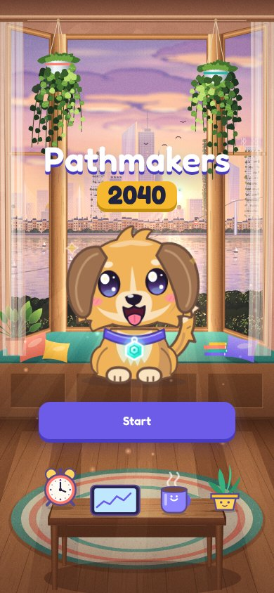
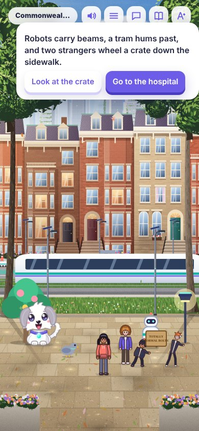
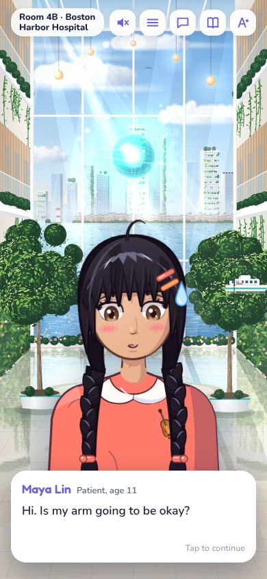
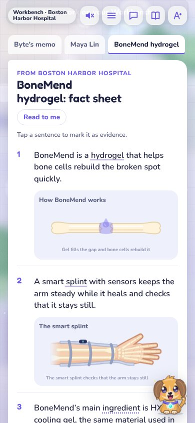
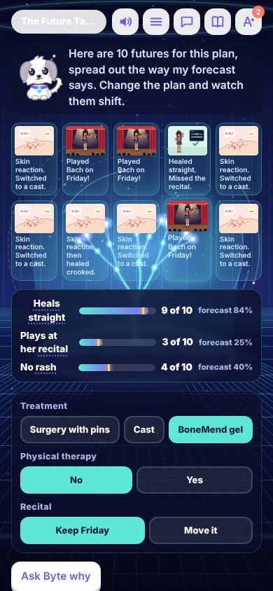
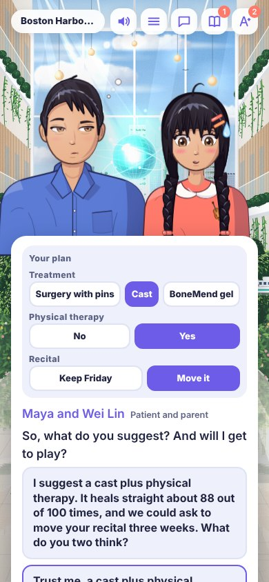
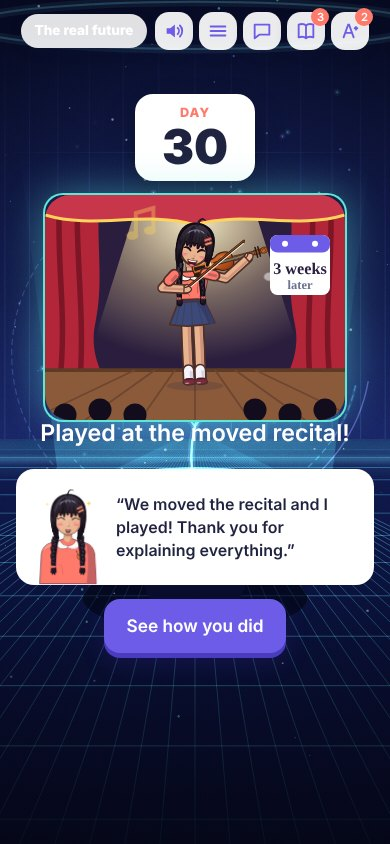
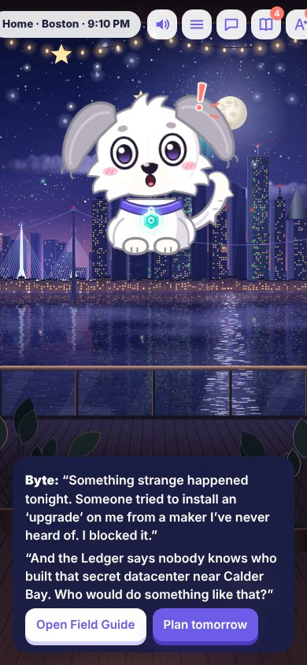

# Pathmakers 2040

A phone-first career game for kids, set in a hopeful 2040 where superintelligent AI quietly runs hospitals, cities and companies, and people still decide what matters. The player works real jobs alongside Byte, a robot-puppy AI partner: reading Byte's animated briefings, finding out what the people involved care about, testing plans on the Future Table, explaining choices honestly, and signing decisions they are accountable for.

## Play

- **On the web:** https://ml-chen.github.io/pathmakers-2040/ (rebuilt from `main` on every push; it goes live once the repo is public and GitHub Pages is set to the `gh-pages` branch under Settings → Pages).
- **On Android:** open [Releases → Android (latest)](../../releases/tag/android-latest) on the phone and tap `Pathmakers2040.apk`. Newer builds install over older ones and keep progress. See [docs/ANDROID.md](docs/ANDROID.md).
- **Offline:** download `index.html` from the [`gh-pages` branch](../../tree/gh-pages) and open it in any browser. The whole game, including voices and music, is one self-contained file.

Best on a phone or in a narrow browser window. Progress saves automatically, and the Menu gives a save code you can copy to another device. Menu → **Unlock every workday** opens every day for testing. Settings: Kid, Teen or Grown-up challenge, and English or 中文 (Chinese is partly translated).

## What's in the game so far

A world map with a calendar (spring 2040 to winter 2042), ranks, Hearts, Coins and three kinds of stars (asking well, deciding well, caring). Each workday follows the rhythm of its real job.

| Place | Day | What you do |
|---|---|---|
| Boston | Getting Hired | Explore the Care Doctor job, meet the team, do a practice case, interview with Dr. Reyes |
| Boston | The Violinist's Wrist | An 11-year-old violinist's broken wrist, nine days before her recital |
| Boston | The Helper That Said Yes | A home-care AI trained on star ratings, and who gets to decide what it may do |
| Boston | Dancing at 104 | Elder Companion: a family meeting and the rules for a 104-year-old's home robot |
| Boston | Grand Rounds | Give a talk about your case to the hospital, and answer a hard question |
| Boston | The Sneeze Recipe | The first villain plot: connect split-up DNA orders before anything is printed |
| Varrow (made-up) | The Lantern Garden | A memorial to the Quiet Year of 2030: stories, exponential growth, and layered safeguards |
| Nome, Alaska | The Calf Who Stopped Eating | Wildlife vet: watch a calf for clues her translator collar can't hear |
| Phoenix, Arizona | The Flood Lot | Community architect: design a skate bowl that doubles as a flood basin |
| Washington, DC | The Robot Safety Bill | Congressional aide: draft a bill, count the votes, and testify |
| Vienna, Austria | The Helpful Shopping AI | AI auditor: test whether a shopping AI quietly steers families |

Also: the Ledger news app (spot the tricks in real and fake stories), Byte's closet, the Field Guide, the Word Book, live chat with Byte, and a progress page for grown-ups. The full plan (16 careers, 8 villain plots, 4 ruins and a finale vote, about 20 to 25 hours) is in [docs/CAMPAIGN.md](docs/CAMPAIGN.md).

## Screenshots

| | | | |
|---|---|---|---|
|  |  |  |  |
| Title | The walk to work | Meeting the patient | Byte's memo |
|  |  |  |  |
| The Future Table | Getting consent | What really happened | Evening cliffhanger |

## What's in a day

1. **Morning and the walk to work:** tap things in each painted scene, pet Byte, and listen to passers-by. Some details are clues.
2. **Meet the people:** face-to-face conversations with recorded voices. Listening closely turns up information that no record has.
3. **Workbench:** graded-reader documents at about a 7th-grade level, where every sentence has its own animated picture and every hard word has a tap definition (saved to the Word Book).
4. **Set the bar:** choose what a good decision means before looking at options.
5. **Future Table:** change the plan and watch 10 typical futures shift, built from Byte's forecast so the futures match the odds.
6. **Consent, then the written decision:** explain the plan honestly, write 2 or 3 sentences, and sign. Byte reviews the writing like a kind editor.
7. **What really happened and the debrief:** the real outcome is rolled from the true odds, and the debrief scores the decision separately from luck and checks how well-calibrated the player's confidence was.

## Build and test

```sh
python3 src/build.py dist/pathmakers.html                 # inline every module into one page
node tests/flow_test.js dist/pathmakers.html              # play every mission headlessly and report errors
node tests/resume_test.js dist/pathmakers.html            # autosave resumes where the player left off
node tools/mission_shots.js dist/pathmakers.html OUT [id] # phone-size screenshots of every step, with contact sheets
node tools/playthrough_video.js dist/pathmakers.html OUT  # a canonical playthrough video
```

Every push to `main` runs these on GitHub and publishes:
- **Android (latest):** the APK.
- **Playtest (latest):** a playthrough video and one contact sheet per mission.
- **Record voices:** speaks every new line (ElevenLabs if the `ELEVENLABS_API_KEY` secret is set, otherwise Kokoro) and commits the clips.
- **Promo (latest):** the Mandarin concept video for RedNote (`promo/rednote`).

`CLAUDE.md` has the module map and the rules the game follows, and `docs/WORKBOARD.md` tracks what's being built and the to-do list. New missions, painted scenes and infographics go in their own files under `src/missions/`, `src/scenes/` and `src/viz/`, and the build picks them up automatically.

## Credits

Voices are recorded with Kokoro (Apache-2.0) through sherpa-onnx, or with ElevenLabs when a key is set. The game was built with Claude, mostly overnight. The world is inspired by the AI Futures Project's scenario "AI 2040"; the game is not affiliated with it. Every person in the game is fictional, and every disaster and villain hideout is in a made-up place.
