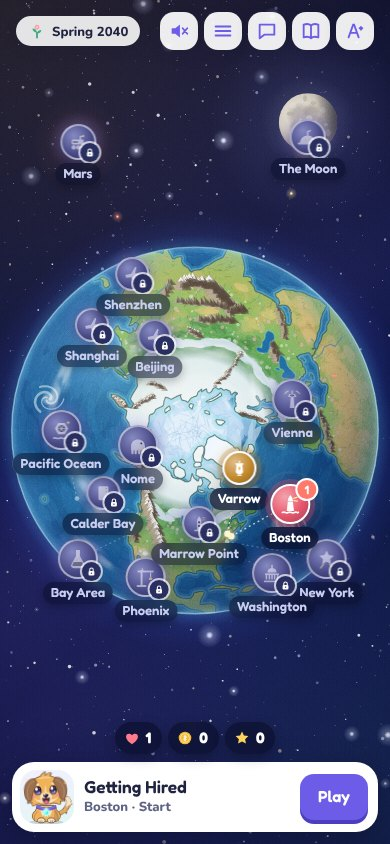
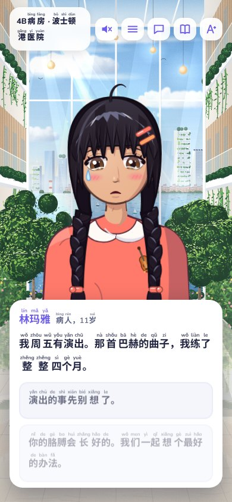
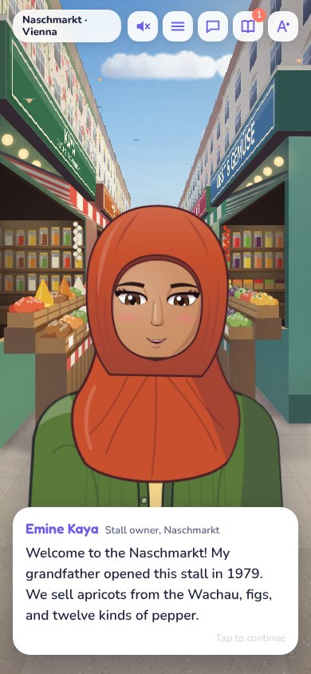
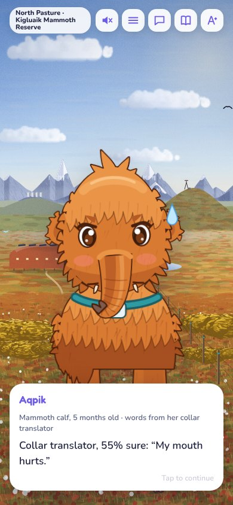
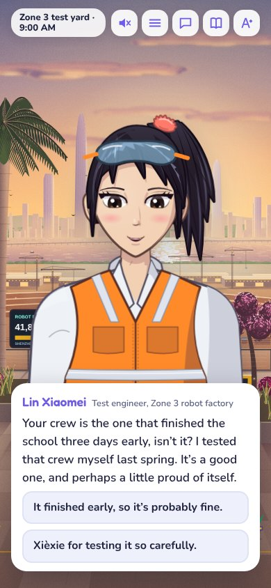
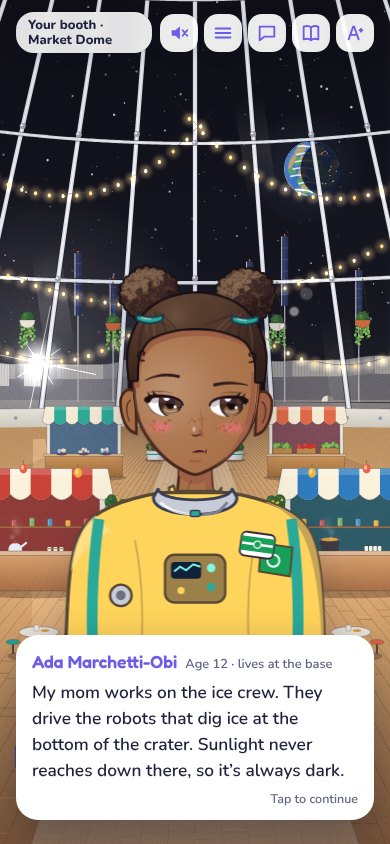
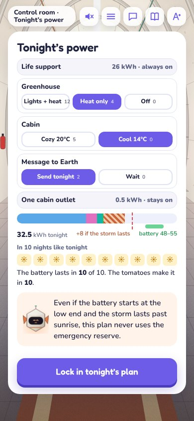

# Pathmakers 2040

Pathmakers 2040 is a phone-first career game for kids who are strong readers. It is set in a hopeful 2040 where nations have agreed to keep AI at expert level until it is proven safe, AI does most of the day-to-day work, and people still make the important decisions and answer for them. The player goes to a different job each day with Byte, a robot-puppy AI partner. On each job the player reads Byte's animated briefings, asks the people involved what they know and what they care about, tests plans on the Future Table, explains the plan to the people it affects, and signs the decision.

## Play

- **In a phone browser:** https://ml-chen.github.io/pathmakers-2040/ (rebuilt from `main` on every push).
- **On Android:** open [Releases → Android (latest)](../../releases/tag/android-latest) on the phone and tap `Pathmakers2040.apk`. On Wi-Fi, the app downloads the newest version of the game from GitHub Pages and uses it the next time it starts. Installing a newer APK over an older one keeps progress. See [docs/ANDROID.md](docs/ANDROID.md).
- **Offline:** download `index.html` from the [`gh-pages` branch](../../tree/gh-pages) and open it in any browser. The whole game, including voices and music, is in that one file.

The game is made for a phone and also works in a desktop browser window. Progress saves automatically, and the Menu gives a save code you can use to move progress to another device. The Menu also has a button that unlocks every workday for testing. In Settings you can pick the challenge level (Kid, Teen or Grown-up) and the language. The Chinese version (中文) is fully translated and can show pinyin above every character.

## Workdays

The world map runs on a calendar from spring 2040 to winter 2042. Each workday follows how its real job works. The player earns ranks, Hearts, Coins and three kinds of stars, for asking good questions, deciding well and caring about people.

| Place | Day | What you do |
|---|---|---|
| Boston | Getting Hired | Learn what a care doctor does, meet the team, try a practice case, and interview with Dr. Reyes |
| Boston | The Violinist’s Wrist | Choose a treatment for an 11-year-old violinist who broke her wrist nine days before her recital |
| Boston | The Helper That Said Yes | Find out why a home-care AI trained on star ratings kept agreeing to risky things, and decide who sets its rules |
| Boston | Dancing at 104 | As an elder companion, run a family meeting about what a 104-year-old's home robot may do |
| Boston | Grand Rounds | Give a talk about your case to the whole hospital and answer a hard question |
| Boston | The Sneeze Recipe | Connect DNA orders that were split up so no one would notice, before anything gets printed |
| Varrow (made-up) | The Lantern Garden | Visit a memorial to the Quiet Year of 2030 and learn about fast-spreading outbreaks and layers of safeguards |
| Nome, Alaska | The Calf Who Stopped Eating | As a wildlife vet, watch a baby woolly mammoth for clues her translator collar can't hear |
| Phoenix, Arizona | The Flood Lot | As a community architect, design a skate bowl that doubles as a flood basin |
| Shenzhen | Who Can Stop a Crew? | Visit the factory that built your robot crew, test every way to stop a crew, and write the rules for who may stop and restart one |
| Shanghai | The Sister Hospital | Talk through a sick child's case with doctors in Shanghai, because each hospital knows something about her illness that the other doesn't |
| The Moon | The Shop at the Rim | Open your first shop at the Moon base and decide what it sells and what its robot clerk may do on its own |
| Mars | One Night of Power | A dust storm will block the Sun all night, so decide what the outpost's battery keeps running |
| Washington, DC | The Robot Safety Bill | As a congressional aide, draft a bill, count the votes and testify |
| Vienna, Austria | The Helpful Shopping AI | As an AI auditor, test whether a shopping AI quietly steers families toward a store owned by the same company that owns the AI |
| Beijing | Trust, Then Check | Join the American and Chinese teams as they read each other's AI rules line by line |

The game also has the Ledger news app, where you find the tricks in real and fake stories. It also has Byte's closet, the Field Guide, the Word Book, live chat with Byte, and a progress page for parents (Menu → For grown-ups). The full plan for the campaign is in [docs/CAMPAIGN.md](docs/CAMPAIGN.md).

## Screenshots

| | | | |
|---|---|---|---|
|  |  |  |  |
| Title | Meeting the patient | Reading on the Workbench | The Future Table |
|  |  |  |  |
| Getting consent | The world map | Chinese, with pinyin | Vienna |
|  |  |  |  |
| Nome, Alaska | Shenzhen | The Moon | Mars |

## A workday, step by step

1. **Morning and the walk to work:** tap things in each painted scene, pet Byte, and listen to people passing by. Some of what you see and hear turns out to be a clue.
2. **Meet the people:** talk face to face, with recorded voices. Careful listening turns up facts that no record has.
3. **Workbench:** read Byte's documents, written at about a 7th-grade level. Every sentence has its own animated picture, and every hard word has a definition you can tap, which is saved to the Word Book.
4. **Set your standard:** choose what a good decision has to do before you look at the options.
5. **Future Table:** change the plan and watch 10 possible futures change. They are built from Byte's forecast, so they match its odds.
6. **Consent, then the written decision:** explain the plan honestly to the people it affects, write 2 or 3 sentences, and sign. Byte gives feedback on the writing.
7. **What really happened, and the debrief:** the real outcome is rolled from the true odds. The debrief scores how good your decision was separately from how lucky the outcome was, and checks whether your confidence matched how things turned out.

## Build and test

```sh
python3 src/build.py dist/pathmakers.html                          # put every module into one page
node tests/flow_test.js dist/pathmakers.html                       # play every mission headlessly and report errors
node tests/resume_test.js dist/pathmakers.html                     # check that autosave resumes where the player left off
node tools/deep_all.js dist/pathmakers.html OUT                    # screenshot every screen and list layout problems in OUT/issues.txt
VIZ_AUDIT_WARN=1 node tools/viz_audit.js dist/pathmakers.html OUT  # check every infographic for overlapping and cut-off labels
```

GitHub runs these workflows:
- **Pages**, on every push to `main`, publishes the game to GitHub Pages.
- **Android**, on every push, builds the APK and publishes it as **Android (latest)**.
- **Playtest**, on every push, plays every mission on a phone-sized screen, a wide screen and in Chinese, and publishes the problem lists, contact sheets and a playthrough video as **Playtest (latest)**.
- **Pinyin**, when Chinese text changes, makes its pinyin.
- **Promo**, when its files change, renders the Mandarin video for RedNote (`promo/rednote`) and publishes it as **Promo (latest)**.
- **Record voices**, run by hand, records every new spoken line.

`CLAUDE.md` has the module map and the rules the game follows. `docs/MISSIONS.md` explains how to add missions, scenes and infographics, and `docs/WORKBOARD.md` tracks what is being built. New missions, painted scenes and infographics go in their own files under `src/missions/`, `src/scenes/` and `src/viz/`, and the build picks them up automatically.

## Credits

The game was built with Claude. The voices are recorded with ElevenLabs when an ElevenLabs key is set, and otherwise with Kokoro (Apache-2.0) through sherpa-onnx. The world is based on the AI Futures Project's scenario "AI 2040: Plan A", and the game is not affiliated with the AI Futures Project. Every person in the game is fictional, and every disaster and villain hideout is in a made-up place.
